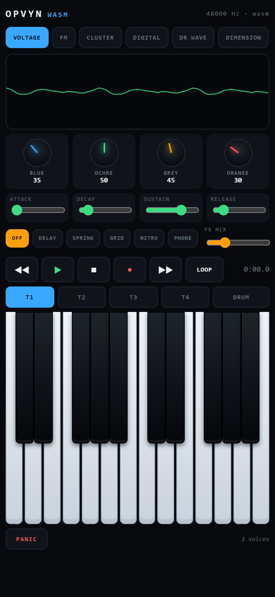

# OPVYN → WebAssembly → iPhone

This folder compiles **OPVYN's engine core** (`Source/Engine.*`, `TapeAudio`, `TapeStorage` — all JUCE-free C++17) to a standalone WebAssembly module and drives it from an `AudioWorklet`, with a touch UI that runs in Safari on iPhone.

No macOS, Xcode, signing or App Store is involved. The engine is OPVYN's own DSP, not an approximation.



## Build

Requirements: Linux/WSL with Emscripten (`emcc`) and a C++17 compiler.

```bash
sudo apt-get install emscripten        # or use emsdk
bash wasm/build.sh
```

`build.sh` compiles `wasm/opvyn_wasm.cpp` plus the engine sources with:

* `-s STANDALONE_WASM=1 --no-entry` (no Emscripten JS runtime)
* `-s ALLOW_MEMORY_GROWTH=1`, initial 64 MiB, max 512 MiB
* exports: `malloc`, `free`, and the `opvyn_*` C API

It writes `build-wasm/opvyn.wasm` (~128 KiB) and copies it to `wasm/web/opvyn.wasm`.

## Run

```python
py -3 wasm/serve.py
```

It prints LAN URLs. On the iPhone, open the URL in Safari, tap **TAP TO START**, then **Share → Add to Home Screen**.

**Secure-context note.** `AudioWorklet` only exists in a secure context (HTTPS or `localhost`). Over plain LAN HTTP — the normal way to open it on a phone — the app detects this and automatically renders the wasm on the main thread through a `ScriptProcessorNode` ("compat" in the status line, ~43 ms extra latency). Both paths were tested; the audio is identical. For worklet latency and offline install, serve over HTTPS or host it on any HTTPS static host.

## Architecture

```
iPhone Safari
  └─ app.js            touch UI: engines, 4 macros, ADSR, FX, transport, keyboard
      └─ AudioWorklet  opvyn-worklet.js
          └─ WebAssembly.instantiate(opvyn.wasm)
              └─ Engine::process()  ← OPVYN DSP, tape, effects
```

* `wasm/opvyn_wasm.cpp` — C ABI: create/prepare, engine select, 4 macros, ADSR, FX, volume, drum mode, note on/off, process, tape play/record/seek/loop, track select/peak.
* `wasm/web/opvyn-worklet.js` — instantiates the wasm with a stub WASI import, renders into the worklet's output buffers, brokers messages.
* `wasm/web/app.js` — engine chips (15), FX chips (11), macro encoders, ADSR sliders, transport, T1–T4, drum toggle, 2-octave multi-touch keyboard, scope.

## Verified (headless Chrome, real audio rendering)

| Check | Result |
|---|---|
| `emcc` build | 128 KiB wasm, no errors |
| Node offline render | peak 0.354, 3 voices, WAV written |
| AudioWorklet (localhost) | 48 kHz, engine ready, peak 0.116 |
| LAN HTTP compat mode | 48 kHz, ScriptProcessor, peak 0.071 |
| Engines 0–10, 14 | all audible |
| Engines 11–13 | silent by design (Sampler/Vocoder need a sample/input; Amp needs input) |
| Effects 1–10 | all pass audio |
| Touch keyboard | key lights and sounds |
| Tape | record → stop → seek → play returned audio (peak 0.095, both modes) |
| 4-track recording | works, wasm memory settles at ~280 MB |
| Layouts | 390×844 and 375×667 fit without scrolling |
| Console/page errors | none |

## Limits

* UI covers synth, macros, ADSR, FX, and basic 4-track tape transport. OPVYN's sequencers, tape editing (lift/drop/split), presets, vocoder input, sampler import and MIDI-learn are not wired yet.
* Over LAN HTTP the engine runs in compatibility mode (ScriptProcessor, higher latency). Use HTTPS for the AudioWorklet path.
* Sampler and Vocoder are silent until sample loading is exposed; Amp needs an input.
* Wasm memory grows to ~280 MB after recording four tape tracks. Fine on recent iPhones; close other tabs on older devices.
* iOS Safari has no Web MIDI. MIDI would require the native/AUv3 route.
* Offline install (`service worker`) needs HTTPS or localhost; over LAN HTTP the app still plays and can be added to the Home Screen, but it will reload from the PC.

## Licensing

OPVYN's original code is MIT. This build uses only the engine core — no JUCE — so the MIT terms apply. The upstream repository's combined desktop binaries are AGPLv3 because they include JUCE; this wasm module does not.
